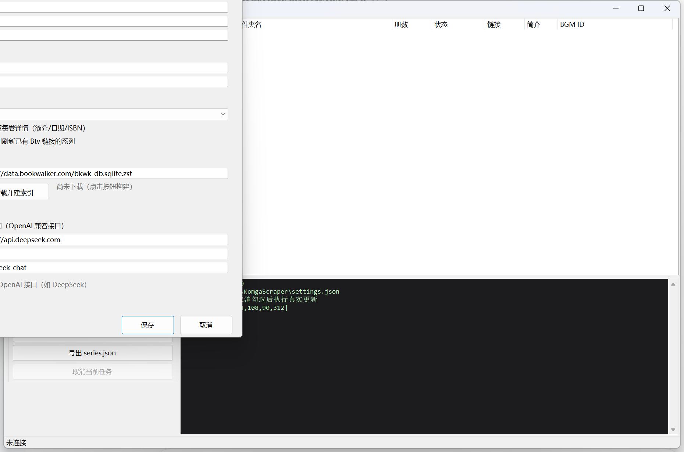

<div align="center">

# MangaMatcher

**Komga 漫画服务器元数据刮削 · 五源匹配链 · 基于 Bangumi**

一个项目，两种形态：🖥 **桌面版 KomgaScraper**（C#/Avalonia，开箱即用）· 🐳 **Docker/Web 版 KomgaBangumi**（Go + Vue 3，NAS 常驻多用户）

[](https://github.com/zzzwannasleep/MangaMatcher/releases/latest)
[](https://github.com/zzzwannasleep/MangaMatcher/releases)
[](https://github.com/zzzwannasleep/MangaMatcher/actions/workflows/release.yml)
[](https://github.com/zzzwannasleep/MangaMatcher/actions/workflows/docker.yml)
[](https://github.com/zzzwannasleep/MangaMatcher/actions/workflows/ci.yml)
[](https://github.com/zzzwannasleep/MangaMatcher/stargazers)
[](LICENSE)
[](https://github.com/zzzwannasleep/MangaMatcher/pkgs/container/mangamatcher)
[](#-docker-部署)
[](server/go.mod)
[](#)
[](web)



</div>

---

刮削逻辑完全同源：**Bangumi → BookWalker → AI → Mox → MangaDex → 百度百科** 五源回退链，宁缺毋滥的精确匹配，失败自动进「待手动匹配」；AI 识别/翻译/补写、逐卷封面、版本标记、Mylar 导出一应俱全。桌面版把它做成单机软件，Docker 版把它搬进浏览器——**选哪边只取决于你在哪用**。

## 🔀 两种形态

| | 🖥 桌面版 KomgaScraper | 🐳 Docker/Web 版 KomgaBangumi |
|---|---|---|
| 技术栈 | C# / .NET 8 / Avalonia 11 | Go（无 CGO 单二进制）+ Vue 3（go:embed 内嵌） |
| 运行方式 | Windows / macOS 安装包，绿色便携 | 容器常驻 NAS / 服务器，`amd64` + `arm64` |
| 账号体系 | 单机单用户 | **admin / master 双角色 + 库级授权** |
| 界面 | 原生桌面 UI，全套动效 | 深色 Web UI：封面卡片墙 / 就地编辑 / 任务差异详情 |
| 适合谁 | 个人电脑上顺手刮一遍 | 家庭服务器 7×24 自动刮，家人各自浏览器里查看纠正 |

## 🚀 快速开始

### 🖥 桌面版

1. 从 [Releases](https://github.com/zzzwannasleep/MangaMatcher/releases/latest) 下载 zip，**解压后**运行 `KomgaScraper.exe`
2. 填入 Komga 地址（`http://localhost:25600`）+ API Key → **测试连接**
3. 选库 → 加载系列 → 勾选 → **刮削元数据**（Dry-run 预览 → 关闭 Dry-run 执行）

### 🐳 Docker 版

```bash
mkdir komgabangumi && cd komgabangumi
curl -fsSL https://raw.githubusercontent.com/zzzwannasleep/MangaMatcher/main/docker-compose.yml -o docker-compose.yml
docker compose up -d
```

打开 **`http://localhost:8080`**，默认账号 `admin / admin123`（首次登录后立即改密码）→ 系统设置里填 Komga 地址 + API Key → 测试连接 → 完成。

> NSFW 搜索需要 [Bangumi Access Token](https://bgm.tv/settings/api)；部分网络需在设置中配置代理（两版都支持，纯 Go / .NET 实现，无额外依赖）。

## ✨ 核心能力

| | |
|---|---|
| 🔍 **五源匹配链** | Bangumi → BookWalker → AI 识别 → AI 智能选择 → Mox → AI 译日文查 BW → MangaDex → 百度百科，逐级回退、宁缺毋滥，失败自动进「待手动匹配」 |
| 🤖 **AI 加持** | OpenAI 兼容接口（默认 DeepSeek）：作品识别 / 多候选智能选择 / 非中文简介自动翻译 / 三源无简介时补写 |
| 🖼 **封面抓取** | 系列封面 + 每卷单行本封面，按卷号对齐，多尺寸候选自动降档 |
| ✏️ **编辑器** | 系列信息 / 标签·别名 / 每卷（标题、卷号、发售日、ISBN、简介、封面）可视化精修 |
| 🔎 **纠正匹配** | 粘贴 Bangumi / 百度百科链接（或纯 ID）→ 解析出标题/作者/简介/封面 → 预览确认后替换落库 |
| 🏷 **版本标记** | 爱藏版/完全版等后缀自动落标签，黑白名单可自定义，多版本系列不再刮平（MACHINE 标签可追溯） |
| 📦 **Mylar 导出** | `series.json` 导出（相对目录结构 + oneshot 特殊名 + 可选封面），Docker 版另支持直写 comicsDir |
| 🌐 **代理** | HTTP/HTTPS/SOCKS4/4a/5 + 账密，Bangumi/封面/BookWalker 共用；Komga 永远直连 |
| ⚡ **本地缓存** | 库数据存本地双层缓存（内存 + SQLite/JSON）：打开即出列表不重拉全库，后台定时对齐 Komga 增量，封面磁盘缓存 + 304，两种形态都有 |

**形态特有**：桌面版 Dry-run 逐字段预览先行、绿色便携不写注册表；Docker 版 Web 封面卡片墙（懒加载扛千卷大库）、任务逐系列差异详情（用了哪个源/匹配到谁/改了哪些字段）、系统日志页在线导出、多用户分权。

## 🐳 Docker 部署

### compose 全示例（与 Komga 同网络，推荐）

Komga 也是容器时，同网络互通后 `KOMGA_URL` 直接填服务名，流量不出宿主机：

```yaml
services:
  komgabangumi:
    image: ghcr.io/zzzwannasleep/mangamatcher:latest   # amd64 / arm64
    container_name: komgabangumi
    restart: unless-stopped
    ports: ["8080:8080"]
    environment:
      ADMIN_USERNAME: admin
      ADMIN_PASSWORD: admin123          # 首次登录后改掉
      KOMGA_URL: http://komga:25600     # 服务名直连
      KOMGA_API_KEY: your-komga-api-key
      BANGUMI_TOKEN: ""                 # 可选：NSFW 搜索需要
      TZ: Asia/Shanghai
    volumes:
      - ./data:/data                    # SQLite + JWT secret，升级不丢
    networks: [komga]

  komga:
    image: gotson/komga:latest
    ports: ["25600:25600"]
    volumes:
      - /path/to/comics:/data:ro
      - ./komga:/config
    networks: [komga]

networks:
  komga:
```

不想用 compose，`docker run` 等价：

```bash
docker run -d --name komgabangumi \
  -p 8080:8080 -v ./data:/data \
  -e ADMIN_USERNAME=admin -e ADMIN_PASSWORD=admin123 \
  -e KOMGA_URL=http://192.168.1.10:25600 -e KOMGA_API_KEY=your-key \
  -e TZ=Asia/Shanghai --restart unless-stopped \
  ghcr.io/zzzwannasleep/mangamatcher:latest
```

### 环境变量

全部是**首次启动种子**——之后在 Web 设置页改的配置存进 SQLite，优先级更高。

| 变量 | 说明 | 默认 |
|------|------|------|
| `PORT` | 监听端口 | `8080` |
| `DATA_DIR` | 数据目录（SQLite + JWT secret） | `/data` |
| `ADMIN_USERNAME` / `ADMIN_PASSWORD` | admin 引导账号（**仅在库内无用户时创建**） | `admin` / `admin123` |
| `KOMGA_URL` | Komga 地址种子 | 空 |
| `KOMGA_API_KEY` | Komga API Key 种子（`X-API-Key`） | 空 |
| `BANGUMI_TOKEN` | Bangumi Access Token（NSFW 搜索需要） | 空 |
| `BANGUMI_API_BASE` | Bangumi API 基址（反代场景可改） | `https://api.bgm.tv` |
| `MOX_API_BASE` / `MANGADEX_API_BASE` / `BAIKE_API_BASE` | 第三方源基址（自建反代场景；空 = 官方站） | 空 |
| `MOX_PACE_MS` | Mox 请求间隔毫秒数 | 空 |
| `TZ` | 时区 | `Asia/Shanghai` |

> 🔒 `ADMIN_PASSWORD` 只在首次引导时生效；API Key 等敏感配置在 `DATA_DIR` 的 SQLite 里，注意备份权限。

### 运维手册

```bash
# 升级（数据在 /data 卷，无损）
docker compose pull && docker compose up -d

# 健康检查（distroless 无 shell，用编排层探活）
curl -f http://localhost:8080/api/health

# 日志
docker logs -f komgabangumi
# 或网页端：admin → 系统日志 → 过滤 / 一键导出

# 备份
tar czf komgabangumi-backup.tgz ./data
```

> ⚠️ **bind mount 权限**：运行层是 `nonroot`（uid 65532）。Linux 上 `./data` 报 Permission denied 时：`sudo chown -R 65532:65532 ./data`
>
> 🌏 **海外部署**：海外 VPS 访问 Bangumi 如遇风控/超时，在设置页配 HTTP/SOCKS 代理。
>
> 🔁 **反向代理**：Nginx/Traefik 反代注意 `client_max_body_size` ≥ 32m（封面上传），纯 REST 无 WebSocket。

## 🧭 使用流程

```text
刮削   选库 → 勾选系列 → 刮削选中（或全库覆盖匹配 / 一键打标 / Mylar 导出）
观察   任务中心卡片看进度；详情逐系列看：用了哪个数据源、匹配到谁、改了哪些字段
纠错   没刮到 / 刮错 → 详情 → 纠正匹配 → 粘贴 Bangumi 或百科链接 → 预览确认 → 落库
精修   详情大窗就地编辑：系列字段 + 逐卷封面/简介/ISBN，保存只提交改动字段
授权   admin 在用户管理给 master 分库；master 只能看到自己的库
```

## 🧪 本地开发

自带六件套 mock（122 系列真实 Bangumi 数据的假库），无需 Docker、无需真实 Komga 即可起全套环境跑测试。

```powershell
node tools/mock-komga.js   # 其余 mock 与后端/前端启动方式见开发文档
go test ./server/... -count=1
```

📖 完整开发指南（mock 全家桶、后端 env、前端 dev、集成测试清单）：[docs/DEVELOPMENT.md](docs/DEVELOPMENT.md)

## 🛠 构建

```powershell
# 桌面版（Windows；macOS 由 CI 产出）
dotnet publish src/KomgaScraper.App/KomgaScraper.App.csproj -c Release -r win-x64 --self-contained false -p:PublishSingleFile=true

# Docker 版（多阶段：node:22-alpine → golang:1.27-alpine → distroless）
docker build -t komgabangumi .
```

推送到 `main` 自动触发云端构建：
- **桌面版**（[release.yml](.github/workflows/release.yml)）：Windows / macOS 双平台产物自动步进小版本，Windows 发布到 [Releases](https://github.com/zzzwannasleep/MangaMatcher/releases)
- **Docker 版**（[docker.yml](.github/workflows/docker.yml)）：`linux/amd64 + linux/arm64` 双架构镜像发布到 GHCR，版本标签用 `docker-v*` 命名空间与桌面发版互不干扰
- **测试门禁**（[ci.yml](.github/workflows/ci.yml)）：`go vet` + 全量测试 + 前端构建，仅认 server/web 路径

## 📐 架构

```text
src/                          桌面版（C# / Avalonia）
  KomgaScraper.App/           UI（主窗口 / 匹配 / 编辑器 / 设置）
  KomgaScraper.Core/          刮削内核（Komga 客户端 / 五源链 / 打标 / Mylar）

server/                       Docker 版后端（Go）
  cmd/server/                 入口（版本注入、日志双写、env 种子）
  internal/auth/              JWT + bcrypt + 角色中间件
  internal/store/             SQLite（users / user_libraries / settings / scrape_state）
  internal/komga/             Komga REST 客户端（X-API-Key，CleanMeta PATCH 规则，multipart 封面）
  internal/bangumi/           Bangumi v0 客户端（≥350ms 限速节拍器）
  internal/sources/           五源客户端：BookWalker 索引 / Mox(串行+520退避) / MangaDex / 百度百科 / AI(缓存) / 代理(纯Go SOCKS)
  internal/scrape/            匹配回退链 / 刮削管线 / 编辑器补丁 / Mylar / 打标 / 差异
  internal/jobs/              worker pool 任务引擎（进度 / 取消 / apply 任务）
  internal/api/               HTTP 路由与 DTO（v1+v2 全端点）
  internal/webdist/           go:embed 前端产物

web/                          Docker 版前端（Vue 3 + Vite）
tools/                        mock 全家桶（komga/bangumi/ai/mox/mangadex/baike）
docs/                         README-full（桌面版）· SPEC.md / SPEC-v2.md（Docker 版 API 契约）
```

## 📖 文档

- 桌面版详细设置、BookWalker 数据源导入（403 问题）、代理配置：[docs/README-full.md](docs/README-full.md)
- Docker 版 API 契约与角色权限规格：[docs/SPEC.md](docs/SPEC.md) · [docs/SPEC-v2.md](docs/SPEC-v2.md)

## 🗺 Roadmap（v3 候选）

CoverCache 磁盘暂存 · 封面 WebP 413 压缩档 · SSE 实时任务日志 · 未记录系列的后台状态补查。

## 📄 许可

[MIT](LICENSE) · 逻辑移植自 [dyphire/KomgaBangumi](https://github.com/dyphire/KomgaBangumi) 与 [dyphire/KomgaMylar](https://github.com/dyphire/KomgaMylar)
